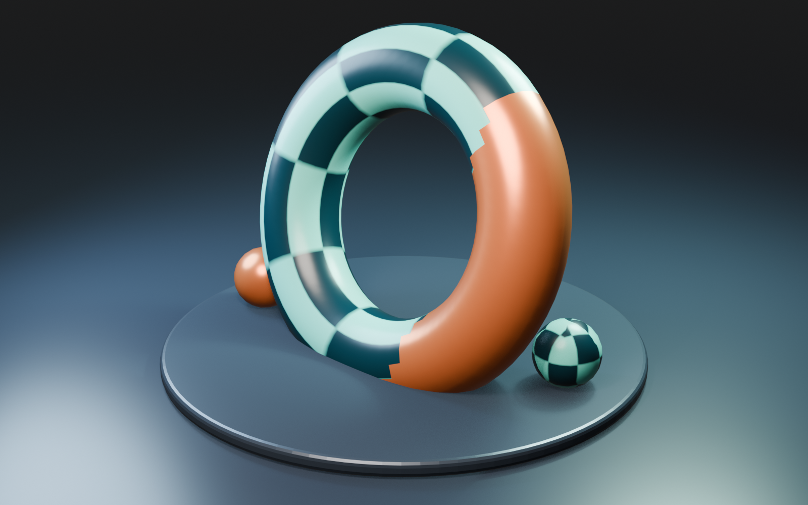
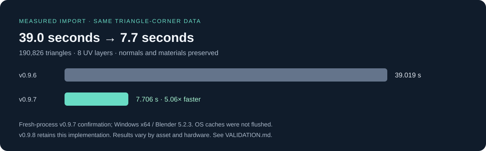
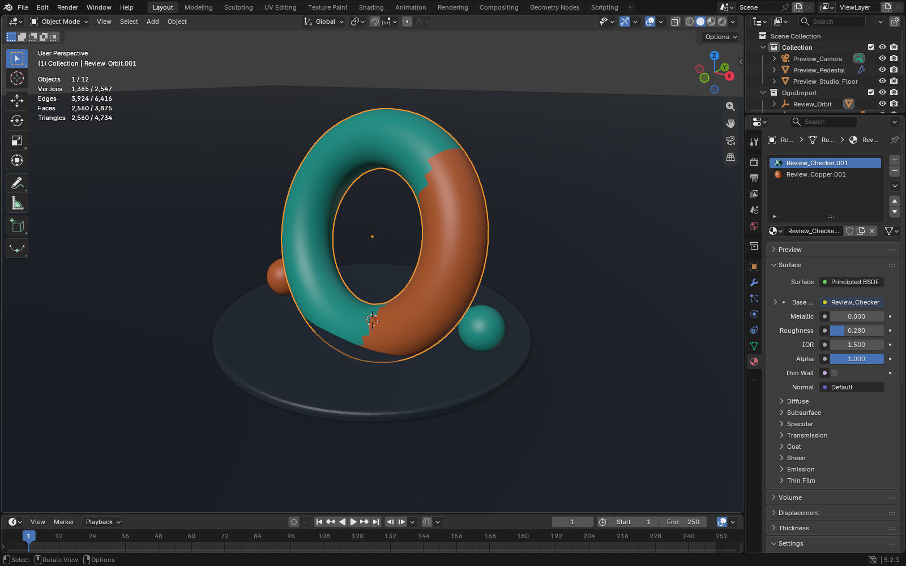

# blender2ogre · Blender 5.2 adaptation

**Private review · v0.9.8 · Windows x64 · Blender 5.2.3 LTS · LGPL 2.1 or later**

Import and export classic OGRE meshes, scenes, materials and animation in Blender 5.2, with faster imports and protected file handling.

[Start the review](docs/REVIEW.md) · [Installation](docs/INSTALLATION.md) · [Patch notes](CHANGELOG.md) · [Validation](docs/VALIDATION.md) · [Known limits](docs/ROADMAP.md)

This is an independent adaptation of [OGRECave/blender2ogre](https://github.com/OGRECave/blender2ogre), based on commit `0d094a40a589752802a9f8823cf08cd8acd6f8fe`. The upstream history, `io_ogre` identity, authors and LGPL notices are preserved. This is not an official OGRECave release.

## What is ready for review

| Area | Result |
| --- | --- |
| Import speed | Faster XML reading, bulk mesh arrays and shared static vertex buffers. The v0.9.7 fresh-process example improved from 39.0 to 7.7 seconds; v0.9.8 retains the same behavior. |
| Materials | Shared asset-pack lookup, imports, abstract templates, variables, inheritance and supported alpha handling. |
| Geometry | Multiple UV layers, custom normals, vertex colors/alpha, unshared meshes and source triangles preserved. |
| Animation | Blender 5 action slots, named clips, matrix-based skeleton import, bind-space fixes and linear node tracks. |
| File handling | Isolated native conversion, source preservation, import rollback and staged export. |
| Release evidence | All 73 regressions passed against the installed v0.9.8 ZIP in isolated Blender 5.2.3. |

## Install the review build

Open this repository's [Releases page](https://github.com/Mjamfan22/blender2ogre-blender5/releases) and select the draft **Blender 5.2 adaptation v0.9.8 — private review**. Download `blender2ogre_Blender_5_2_v0.9.8.zip` from its assets. Draft releases are visible to repository users with appropriate write access.

In Blender, use **Edit → Preferences → Add-ons → Install from Disk**, select the ZIP and enable **OGRE Importer-Exporter (.scene, .mesh, .skeleton)**. Fully restart Blender after replacing an older copy, then re-import assets to rebuild their data/materials. Keep one active `io_ogre` installation. See [the complete instructions](docs/INSTALLATION.md).

The ZIP contains only the installable `io_ogre` folder, its documentation, licenses and bundled Windows tools. You do not need the GitHub checkout or its development files at runtime.

## Evidence, not quality reduction

The complete 190,826-triangle comparison found zero corner differences in positions, normals, all eight UV layers and material assignments. Shared geometry uses 121,422 vertices instead of three duplicated copies. Timings vary by asset and hardware; binary meshes still use the native XML converter. See [measurement conditions and current results](docs/VALIDATION.md).

The screenshots and render use a generated demonstration asset. They are not engine-rendering certification or a picture of the user's private model pack. [Image provenance and reproduction](docs/SCREENSHOTS.md).

## Review scope

The private repository contains the adapted source on `main`, the exact upstream baseline on `upstream/master`, a draft comparison PR and a draft release. Nothing was submitted to OGRECave or published publicly. GitHub requires public-repository forks to remain public, so this is a separate private repository with upstream Git ancestry rather than a GitHub fork-network member.

Windows x64, Blender 5.2.3 and classic OGRE are verified. Linux, full OGRENext rendering, arbitrary custom shaders, automatic compound colliders, AO export and a direct binary backend still need work. The [dated audit of 27 upstream issues](docs/UPSTREAM_ISSUES.md) distinguishes fixes from remaining work.

## Development and licensing

[Contributing and local checks](CONTRIBUTING.md) · [Security and bundled tools](SECURITY.md) · [Attribution](NOTICE.md) · [LGPL license](LICENSE.txt)

Source, synthetic tests and sanitized results are included. Local profiles, caches, original model packs and downloaded reporter archives are excluded. The self-contained 65-check subset can run from a clean checkout; the complete 73-check release run additionally used locally held fixtures and comparison snapshots. CI checks source/package integrity and documentation, and does not claim to run the Blender regression suite.
